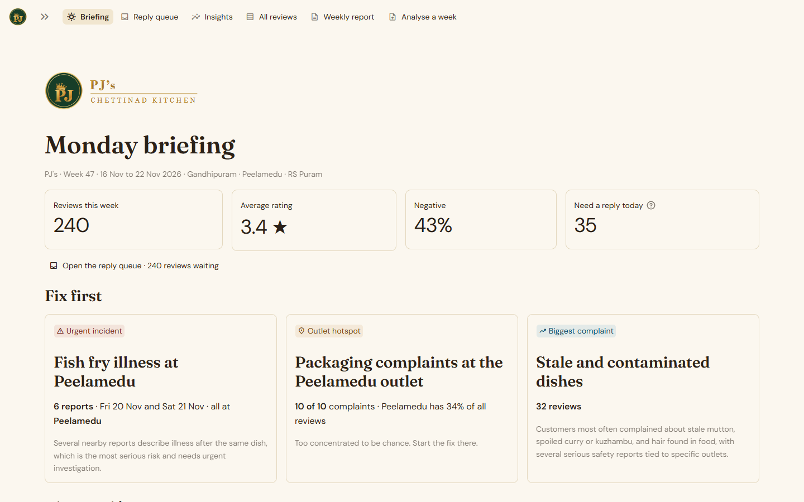
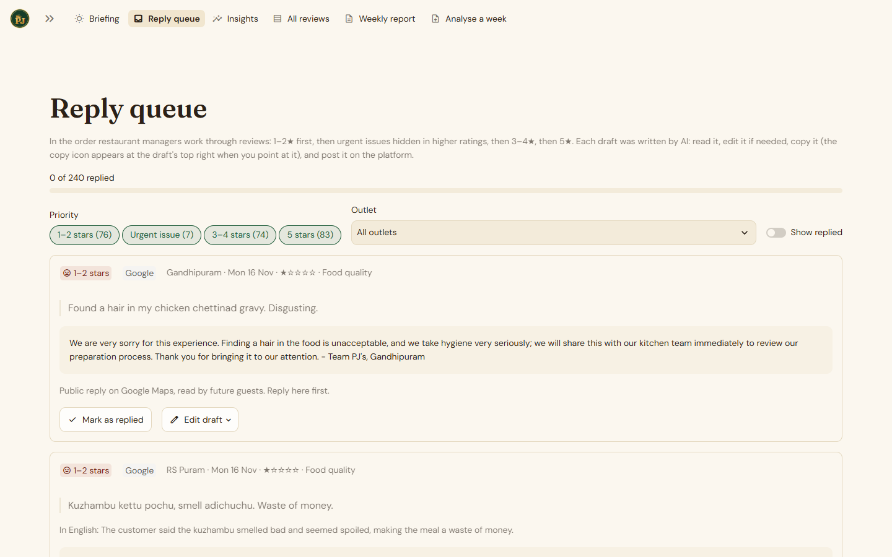
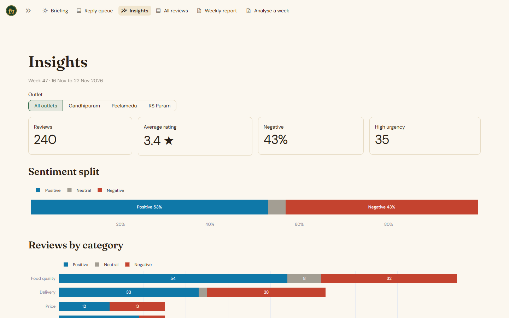
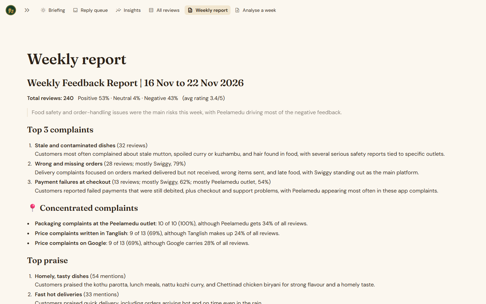
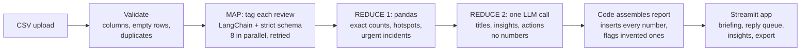

<div align="center">


# ReviewLens

**Turn a week of restaurant reviews (English, Tamil and Tanglish) into a 5-minute Monday briefing, a prioritised reply queue and a weekly report.**


https://github.com/user-attachments/assets/1c121c9e-e0d9-48d5-93db-09f9b3594848

*80-second demo with voice-over and captions. Turn the sound on.*

</div>

---

## Contents

[The problem](#the-problem) · [What it does](#what-it-does) · [Quick start](#quick-start) · [How it works](#how-it-works) · [Evaluation](#evaluation) · [Design decisions](#design-decisions) · [Project structure](#project-structure)

## The problem

**PJ's** is a Chettinad kitchen with three outlets in Coimbatore (RS Puram, Gandhipuram and Peelamedu). Every week it gets hundreds of reviews on Google, Zomato and Swiggy, written in English, Tamil and Tanglish (Tamil in English letters). Reading them by hand takes hours, urgent complaints such as food poisoning or a vegetarian sent chicken get missed for days, and nobody can say with numbers what customers complain about most, or which outlet is causing it.

> PJ's is a fictional restaurant and its reviews are synthetic, generated with known patterns so the analysis can be checked against an answer key (see [Evaluation](#evaluation)).

## What it does

| | |
|---|---|
| **Monday briefing**<br>Opens on what needs a decision: the most serious incident, complaints concentrated in one outlet or platform, this week's 3 actions, and an outlet comparison. |  |
| **Reply queue**<br>Every review in the order a manager should answer it: 1–2★ first, then urgent issues hidden in higher ratings, then 3–4★, then 5★. Each has an AI-drafted reply signed by the right outlet, ready to edit, copy and mark as done. |  |
| **Insights**<br>Sentiment and complaint categories for the whole restaurant or one outlet at a time. |  |
| **Weekly report**<br>Top complaints and praise, concentrated complaints, urgent incident clusters and action items. Every number in it is calculated in code. |  |

Every review is tagged with **sentiment, category, urgency, language, a one-line English summary and a suggested reply**, and the enriched table exports as a CSV that opens correctly in Excel, Tamil text included.

## Quick start

Requires **Python 3.12** and an [OpenAI API key](https://platform.openai.com/api-keys). No key? The app opens on a pre-analysed demo week, so you can explore everything except analysing new data.

```powershell
git clone https://github.com/Prithvi11J/reviewlens-feedback-analyzer.git
cd reviewlens-feedback-analyzer
py -3.12 -m venv .venv
.venv\Scripts\activate
pip install -r requirements.txt
copy .env.example .env          # then paste your OpenAI key into .env
streamlit run app.py
```

<details>
<summary>macOS / Linux</summary>

```bash
python3.12 -m venv .venv
source .venv/bin/activate
pip install -r requirements.txt
cp .env.example .env
streamlit run app.py
```
</details>

Run `streamlit run app.py` **from the project folder**: Streamlit reads the PJ's theme from `.streamlit/config.toml` in the folder it is started from.

### Use your own reviews

Open **Analyse a week** and upload a CSV:

| Column | Required | Example |
|---|---|---|
| `review_id` | yes | `R-1042` |
| `date` | yes | `2026-11-20` |
| `platform` | yes | `Swiggy` |
| `rating` | yes | `1` |
| `review_text` | yes | `Saapadu nalla irundhuchu but bill la extra charge pottanga` |
| `outlet` | optional | `Peelamedu` (enables outlet comparison and hotspots) |

Empty and duplicate rows are removed before anything is sent to the model. Set `RESTAURANT_NAME` and `RESTAURANT_DESCRIPTION` in `.env` to use ReviewLens for another restaurant.

## How it works



1. **Map** ([chains.py](reviewlens/chains.py), [analyze.py](reviewlens/analyze.py)): `prompt | llm.with_structured_output(ReviewAnalysis, strict=True)`, run with `chain.batch(max_concurrency=8)`. Allowed values are `Literal` types in a Pydantic schema ([schemas.py](reviewlens/schemas.py)), so the model cannot return a category that doesn't exist. A review that still fails after 3 attempts is marked `needs_review` instead of crashing the run. 240 reviews take about 45 seconds.
2. **Reduce, numbers** ([aggregate.py](reviewlens/aggregate.py)): pandas computes every count and percentage, the outlet comparison, and **hotspots**: complaint types concentrated in one outlet, platform or language, kept only when a binomial test says chance would produce them less than 1% of the time.
3. **Reduce, words** ([report.py](reviewlens/report.py)): one LLM call reads those facts and returns titles, insights, incident clusters and action items. Code checks the result (right themes, real review IDs), assembles the report and inserts every number itself.
4. **App** ([app.py](app.py), [app_pages/](app_pages)): a multipage Streamlit app themed entirely through `config.toml`, with session state so filtering never calls the API again.

## Evaluation

The demo week ([data/sample](data/sample)) has 240 synthetic reviews (162 English, 57 Tanglish, 21 Tamil script) across 3 outlets, plus 3 deliberately broken rows, and a separate **answer key** the model never sees. Results with `gpt-5.4-mini`:

| Tag | Accuracy |
|---|---|
| category | 98.3% |
| sentiment | 99.2% |
| language | 99.6% |
| urgency | **100%** (every truly urgent review caught) |

Most remaining misses are genuinely ambiguous, for example *"Portion of the mutton biryani has become really small for the same price"* (food quality or price?).

**Planted-pattern test.** Four patterns were hidden in the data on purpose. The weekly report found all four:

| Hidden in the data | Found in the report |
|---|---|
| Delivery complaints mostly from Swiggy | "Wrong and missing orders (28 reviews; mostly Swiggy, 79%)" |
| Billing complaints mostly in Tanglish, on Google | "Price complaints written in Tanglish: 9 of 13 (69%), although Tanglish makes up 24% of all reviews" |
| 6 food-poisoning reports about one dish at one outlet in 2 days | "Fish fry illness at Peelamedu: 6 reports, on Fri 20 Nov and Sat 21 Nov, all at Peelamedu", ranked first |
| Every packaging complaint from one outlet | "Packaging complaints at the Peelamedu outlet: 10 of 10 (100%), although Peelamedu gets 34% of all reviews" |

Reproduce it: `python scripts/make_test_data.py`, `python scripts/run_batch.py` (accuracy), `python scripts/make_report.py` (pattern check).

## Design decisions

- **Numbers come from code, words come from the LLM.** The model writes titles and insights; every count and percentage is calculated by pandas and inserted by code. Any number in AI-written text that isn't in the data is flagged in a quality check.
- **Rules in a prompt are requests; rules in code are guarantees.** When the model wrote about a 41% "pattern" despite being told to ignore anything under 50%, the fix was to remove sub-threshold patterns from the facts it sees. When it summarised the wrong theme, the code now checks the themes and asks again.
- **Patterns must beat chance.** An outlet that gets a third of all reviews will get about a third of each complaint type. Hotspots are compared against that baseline with a binomial test, so "4 of 6" (an 11% fluke) is ignored while "10 of 10" (0.002%) is reported.
- **Incidents are bursts.** Urgent clusters are ranked by reports per day, so a sudden food-poisoning spike outranks a slow, recurring problem, and the ranking doesn't change between runs.
- **Strict "high" urgency.** High is reserved for health and safety, money taken wrongly, abusive staff, and wrong or missing orders. A late, cold delivery is a clear complaint, not an emergency, which keeps the urgent queue short enough to clear every day. Telling the model to *judge what happened, not how upset the customer sounds* raised urgency accuracy from 97.5% to 100%.
- **Built on how restaurants actually work.** The reply order (1–2★ first, then hygiene and illness) and the platform tips (Google replies are public; Swiggy feedback stays in the partner app) follow published guidance for Indian restaurants, such as [Repuva's review-management guide](https://repuva.com/blog/restaurant-review-management-guide/). The briefing is exception-first, like a good [weekly operations review](https://restaurantoperatorlab.com/restaurant-manager-weekly-review-meeting/).
- **IDs never pass through the LLM.** `review_id` is attached from the input after analysis, and incident clusters are checked against the real urgent IDs.

## Command-line tools

| Command | What it does | API cost |
|---|---|---|
| `python scripts/check_setup.py` | Checks the key and model with one tiny call | 1 call |
| `python scripts/run_batch.py [file.csv]` | Tags a whole CSV, saves `outputs/<name>_enriched.csv`, scores accuracy if an answer key exists | 1 call per review |
| `python scripts/run_batch.py --eval-only` | Re-scores the last run against the answer key | free |
| `python scripts/show_stats.py` | Prints the exact weekly numbers | free |
| `python scripts/make_report.py` | Writes the weekly report and checks the planted patterns | 1–3 calls |
| `python scripts/make_test_data.py` | Regenerates the synthetic week (fixed seed) | free |

## Tests

```powershell
python -m pytest
```

56 tests run in about 20 seconds with no API calls: schema rules, CSV validation, batch failure handling with a fake chain, exact statistics, percentages that always sum to 100, hotspots and the chance test, report assembly and retries, invented-number detection, reply-queue order, and headless tests of every app page.

## Project structure

```
reviewlens-feedback-analyzer/
├── app.py                  # Streamlit entry point (frame and navigation)
├── app_pages/              # briefing, reply queue, insights, reviews, report, upload
├── ui/state.py             # shared app state and cached stats
├── reviewlens/             # the analysis package (no Streamlit inside)
│   ├── config.py           # .env settings, the LLM, restaurant name
│   ├── schemas.py          # ReviewAnalysis: 6 fields and their allowed values
│   ├── chains.py           # per-review LangChain chain (map)
│   ├── data.py             # CSV loading and validation
│   ├── analyze.py          # batching, retries, needs_review
│   ├── aggregate.py        # exact statistics, hotspots, outlet stats (reduce: numbers)
│   ├── report.py           # report chain, checks, assembly (reduce: words)
│   ├── replies.py          # reply-queue priority
│   └── charts.py           # colour-blind-safe Plotly charts
├── scripts/                # command-line tools (see above)
├── tests/                  # pytest suite
├── data/sample/            # synthetic week + answer key
├── data/demo/              # pre-analysed results for demo mode
├── assets/                 # PJ's logo
├── docs/                   # screenshots and demo video
├── .streamlit/config.toml  # PJ's theme
├── .env.example            # settings template (.env itself is git-ignored)
└── requirements.txt        # pinned dependencies
```

## Limitations and next steps

- The test data is synthetic and reuses template sentences; real reviews are messier. The next step is a week of real (anonymised) reviews.
- Reply status lasts for the browser session only; the reply log CSV is the workaround. A small database would make it persistent.
- Ideas: week-over-week trends, replies in the reviewer's own language, a Monday email of the briefing, and an "ask your reviews" search box (RAG over the tagged reviews).

## Acknowledgements

Built as the Gen AI (LangChain) project of the **Social Eagle AI Academy** intermediate track. The demo video's voice-over and music were generated with ElevenLabs.

## License

[MIT](LICENSE)
