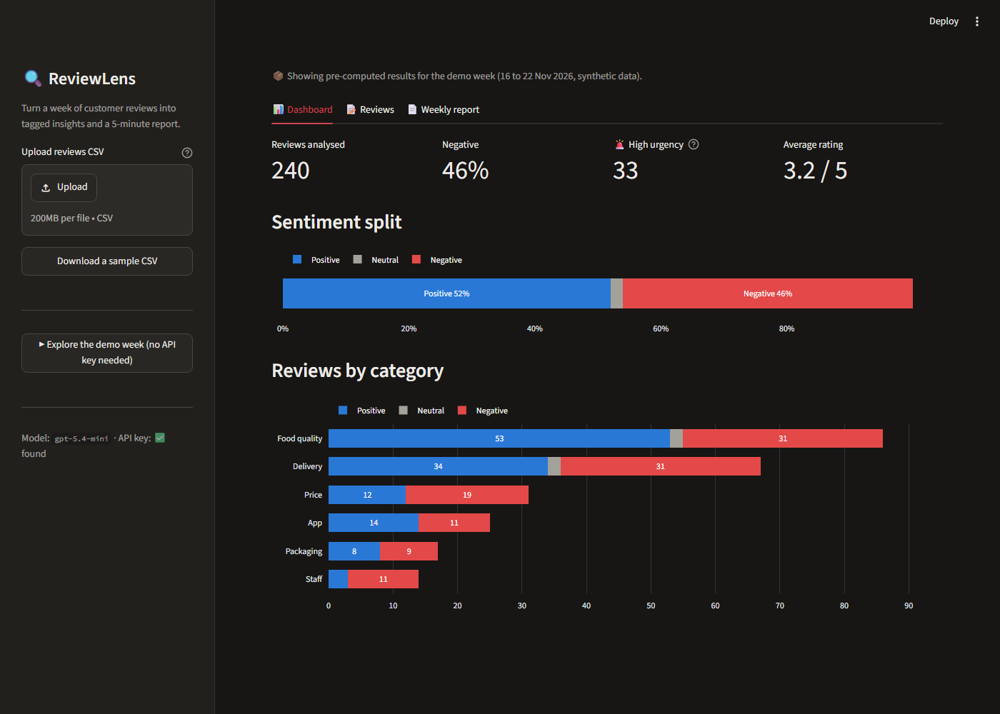

# ReviewLens: Customer Feedback Analyzer

> Turn a week of raw customer reviews (English, Tamil, Tanglish) into tagged, prioritised insights and a weekly report a manager can act on in five minutes.



Built with **LangChain**, **OpenAI**, **pandas** and **Streamlit** as the Gen AI track project of the Social Eagle AI Academy (intermediate level).

## The problem

A restaurant or online store gets 200 to 500 reviews a week from Google, Zomato, Swiggy and Amazon, in English, Tamil and Tanglish. A manager reads them by hand, urgent complaints (food poisoning, wrong orders, rude staff) get missed for days, and nobody can say with numbers what customers complain about most.

## What it does

| Feature | Details |
|---|---|
| **Upload** | CSV with `review_id, date, platform, rating, review_text`; empty and duplicate rows are removed before anything is sent to the LLM |
| **Tag every review** | sentiment, category, urgency, language, a one-line English summary and a polite suggested reply, enforced by a strict schema |
| **Mixed languages** | Tamil script and Tanglish reviews are understood and summarised in English |
| **Weekly report** | top complaints, top praise, clusters of urgent incidents, 3 action items |
| **Dashboard** | sentiment split, category chart, a **HIGH-urgency filter**, platform/category/sentiment filters |
| **Export** | enriched CSV that opens correctly in Excel (Tamil text included) |
| **Demo mode** | explore a pre-computed week without an API key: open the app with `?demo=1` |

## How it works

```
 CSV ──► 1. Validate ──► 2. MAP: tag each review ──► 3. REDUCE (pandas) ──► 4. REDUCE (LLM) ──► 5. Dashboard
         columns,        LangChain chain, batched     exact counts and        writes the words,     + report
         empty rows,     8 at a time, retried,        percentages             code inserts the      + CSV export
         duplicates      strict JSON schema                                   numbers
```

1. **Validate** ([data.py](reviewlens/data.py)): forgiving about header case and spacing, strict about required columns.
2. **Map** ([chains.py](reviewlens/chains.py), [analyze.py](reviewlens/analyze.py)): `prompt | llm.with_structured_output(ReviewAnalysis, strict=True)`, run with `chain.batch(max_concurrency=8)`. Every value must be one of the allowed options ([schemas.py](reviewlens/schemas.py)). A review that still fails after 3 attempts is marked `needs_review` instead of crashing the run.
3. **Reduce, numbers** ([aggregate.py](reviewlens/aggregate.py)): pandas computes every count and percentage, including top complaint themes with their main platform and language.
4. **Reduce, words** ([report.py](reviewlens/report.py)): one LLM call reads those facts and returns titles, insights, incident clusters and action items. The code assembles the report and inserts every number itself.
5. **App** ([app.py](app.py)): Streamlit UI with session state, so filtering never re-calls the API.

## Quick start

Requires **Python 3.12** and an OpenAI API key.

```powershell
git clone https://github.com/Prithvi11J/reviewlens-feedback-analyzer.git
cd reviewlens-feedback-analyzer
py -3.12 -m venv .venv
.venv\Scripts\activate
pip install -r requirements.txt
copy .env.example .env          # then paste your OpenAI key into .env
python scripts/check_setup.py   # should print [OK]
streamlit run app.py
```

On macOS/Linux use `python3.12 -m venv .venv`, `source .venv/bin/activate` and `cp .env.example .env`.

No API key? Run the app and click **Explore the demo week**, or open `http://localhost:8501/?demo=1`.

### Command-line scripts

| Command | What it does | API cost |
|---|---|---|
| `python scripts/try_one_review.py` | Tags the 3 sample reviews from the brief | 3 calls |
| `python scripts/run_batch.py [file.csv]` | Validates and tags a whole CSV, saves `outputs/<name>_enriched.csv`, scores accuracy if an answer key exists | 1 call per review |
| `python scripts/run_batch.py --eval-only` | Re-scores the last run against the answer key | free |
| `python scripts/show_stats.py` | Prints the exact weekly numbers | free |
| `python scripts/make_report.py` | Writes `outputs/weekly_report.md` and checks the planted patterns | 1 call |
| `python scripts/make_test_data.py` | Regenerates the synthetic test week (fixed seed) | free |

## Sample input and output

**Input** (a Tanglish review from the project brief; it means "the food was good, but they added an extra charge to the bill"):

```csv
review_id,date,platform,rating,review_text
R-1043,2026-10-04,Google,2,"Saapadu nalla irundhuchu but bill la extra charge pottanga"
```

**Output A: one analysed review**

```json
{
  "review_id": "R-1043",
  "sentiment": "negative",
  "category": "price",
  "urgency": "medium",
  "language": "Tanglish",
  "summary": "The customer said the food was good, but extra charges were added to the bill.",
  "suggested_reply": "Thank you for your feedback. We're glad you liked the food, and we're sorry about the extra charge on the bill. Please share the bill details with us so we can check what happened and clarify it for you."
}
```

**Output B: weekly report** (excerpt; full version in [data/demo/weekly_report.md](data/demo/weekly_report.md))

```text
Weekly Feedback Report | 16 Nov to 22 Nov 2026
Total reviews: 240   Positive 52% · Neutral 2% · Negative 46%

Top 3 complaints
1. Late, cold deliveries (31 reviews; mostly Swiggy, 74%)
2. Spoiled and unsafe food (31 reviews)
3. Billing and extra charges (19 reviews; mostly Google, 84%; mostly Tanglish reviews, 74%)

⚠️ Urgent: 33 reviews need a reply within 24 hours
- Fish fry made customers sick: 6 reports, on Fri 20 Nov and Sat 21 Nov. ...

Action items
1. Investigate the fish fry issue immediately and stop selling that item until the kitchen confirms it is safe.
```

## Evaluation

The test week ([data/sample](data/sample)) is **synthetic**: 240 reviews generated from hand-written templates (161 English, 63 Tanglish, 16 Tamil script) plus 3 deliberately broken rows, with a separate answer key the LLM never sees. Results with `gpt-5.4-mini`:

| Field | Accuracy |
|---|---|
| category | 98.3% |
| sentiment | 98.3% |
| language | 98.8% |
| urgency | 99.6% (every truly urgent review caught) |

Most of the remaining misses are genuinely ambiguous, for example *"Portion size has become really small for the same price"* (food quality or price?).

**Planted-pattern test.** Three patterns were hidden in the data on purpose. The weekly report found all three:

| Planted | Found in the report |
|---|---|
| Delivery complaints mostly from Swiggy | "Late, cold deliveries (31 reviews; mostly Swiggy, 74%)" |
| Extra-charge complaints mostly Tanglish, on Google | "Billing and extra charges (mostly Google, 84%; mostly Tanglish reviews, 74%)" |
| 6 food-poisoning reports about one dish in 2 days | "Fish fry made customers sick: 6 reports, on Fri 20 Nov and Sat 21 Nov", ranked first |

## Design decisions

- **Numbers come from pandas, words come from the LLM.** The LLM tags reviews and writes the report text. Every count and percentage is calculated in code and inserted by code, so it is exact and repeatable. As a final check, any number in the AI-written text that does not exist in the data is flagged in the report.
- **Strict "high" urgency.** `high` is reserved for health/safety issues, money taken wrongly, abusive staff, and wrong or missing orders, following the brief's definition table. A late, cold delivery is a clear complaint (`medium`), not an emergency. This keeps the urgent queue short enough that the team actually clears it every day. The model initially over-escalated emotional complaints ("kids slept hungry"), so the prompt now says *judge what happened, not how upset the customer sounds*, with contrastive examples written independently of the test data. Urgency accuracy went from **97.5% to 99.6%**.
- **A pattern needs at least 50%.** The report only says "mostly Swiggy" when one platform or language makes up at least half of a theme, so random variation is never presented as a finding.
- **IDs never pass through the LLM.** `review_id` is attached from the input data after analysis, and incident clusters are checked against the real urgent IDs, so an ID can't be mistyped or invented.
- **The model is swappable.** The LLM is created in one place ([config.py](reviewlens/config.py)); switching to another model or provider changes one function.

## Tests

```powershell
python -m pytest
```

26 offline tests run in seconds with no API calls: schema rules, CSV validation, batch failure handling (with a fake chain), exact statistics, percentages that always sum to 100, report assembly, invented-number detection, and a headless smoke test of the Streamlit app.

## Project structure

```
reviewlens-feedback-analyzer/
├── app.py                  # Streamlit app
├── reviewlens/             # core package
│   ├── config.py           # loads .env, builds the LLM
│   ├── schemas.py          # ReviewAnalysis: the 6 fields and their allowed values
│   ├── chains.py           # per-review LangChain chain (map)
│   ├── data.py             # CSV loading and validation
│   ├── analyze.py          # batching, retries, needs_review
│   ├── aggregate.py        # exact weekly statistics (reduce, numbers)
│   ├── report.py           # report chain, assembly, number check (reduce, words)
│   └── charts.py           # dashboard charts
├── scripts/                # command-line tools (see table above)
├── tests/                  # pytest suite
├── data/sample/            # synthetic test week + answer key
├── data/demo/              # pre-computed results for demo mode
├── docs/                   # README screenshot
├── .env.example            # template for secrets (.env itself is git-ignored)
└── requirements.txt        # pinned dependencies
```

## Limitations and next steps

- The test data is synthetic, and many reviews reuse the same template sentences. Real reviews will be messier.
- One run costs roughly one small LLM call per review. Results are not cached between runs yet.
- Ideas from the brief's stretch goals: compare with last week (trend arrows), reply in the review's own language, email the report every Monday. Another idea is an "ask your reviews" search box (RAG over the tagged reviews).

## License

[MIT](LICENSE)
